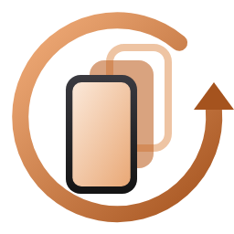

<div align="center">



# Phone Backup

### A calm, private way to protect your Android phone

Back up, restore, and move your Android phone from a Windows PC.
Your data stays in an ordinary folder you can open, copy, and keep wherever you choose.

[](https://github.com/mitunmanav/phone-backup/releases/latest)
[](https://github.com/mitunmanav/phone-backup/releases)
[](https://github.com/mitunmanav/phone-backup/actions/workflows/ci.yml)
[](LICENSE)

[**Download**](https://phonebackup.oddlybuilt.in/download) ·
[Website](https://phonebackup.oddlybuilt.in) ·
[Guide](https://phonebackup.oddlybuilt.in/guide) ·
[FAQ](https://phonebackup.oddlybuilt.in/faq)

<br>

<picture>
  <source srcset="docs/app-dark.png" media="(prefers-color-scheme: dark)">
  
</picture>

</div>

## Why Phone Backup?

Most backup tools make your phone's data dependent on an account, a subscription, or a
proprietary archive. Phone Backup takes a simpler approach:

- **Your backup is yours.** It is a normal folder on your PC, not a cloud-only copy.
- **See what will happen.** Choose what to copy, review changes, and restore everything or
  only selected items.
- **Keep control of sensitive data.** There is no account, advertising, or telemetry.
- **Start without a complicated setup.** The app explains the steps for your phone and
  supports USB, USB debugging, and Wi-Fi connections.

## What you can do

| | |
|---|---|
| **Back up a phone** | Copy photos, videos, documents, downloads, SD cards, and other files. With USB debugging enabled, also save installed apps, contacts, call history, messages, and calendar events. |
| **Keep backups current** | Run the same backup again to copy only files that changed. Pause a job and continue later. |
| **Restore safely** | Restore all files and apps, or select individual items. Existing files are left untouched. The app can verify every restored file with SHA-256 checksums. |
| **Move to another Android phone** | Back up one phone, review the proposed changes, and transfer the content to another connected phone. |
| **Read and export personal data** | Open contacts, calls, messages, and calendar data from a backup. Export it to CSV, HTML, `contacts.vcf`, printable pages, or `.ics`. |
| **Tidy up your phone** | Find duplicate files, convert HEIC photos to JPG, merge duplicate contacts, and remove phone files only after they have been verified in a backup. |
| **Use your preferred connection** | Connect over USB file transfer, USB debugging, or Wi-Fi. Wi-Fi pairing can be started by scanning a QR code. |
| **Control the phone from your PC** | Launch [scrcpy](https://github.com/Genymobile/scrcpy) when it is available next to the app or on your `PATH`. |

## Get started

1. **[Download the latest Windows release](https://phonebackup.oddlybuilt.in/download).**
   The release is a portable `.exe`; there is no installer.
2. **Connect and unlock your phone.**
   For photos and files, choose **File transfer** in the phone's USB notification. For
   apps and personal data, also enable **USB debugging** in Developer options.
3. **Open Phone Backup and follow the connection guide.**
4. **Choose what to save and select _Back up now_.**

The [step-by-step guide](https://phonebackup.oddlybuilt.in/guide) covers Wi-Fi pairing,
restoring to a phone, and moving to a new phone. If a device does not allow a particular
kind of data to be read, Phone Backup explains that limitation instead of pretending the
backup is complete.

## Connection modes

### USB file transfer

Best for photos, videos, documents, downloads, and other files. This is the least
intrusive option and does not require Developer options.

### USB debugging

Required for installed apps, contacts, call history, messages, calendar events, restore,
and phone-to-phone transfer. Phone Backup can help download Google's `adb` when it is
missing.

### Wi-Fi

Useful when a cable is inconvenient. Pair through Android's Wireless debugging screen or
scan the QR code shown by the app. Both devices stay on your local network; the transfer
does not go through Phone Backup's servers.

## Privacy and safety

Phone Backup is designed to be useful without collecting anything:

- **No account, cloud storage, ads, or tracking.**
- **No data uploads.** The app only goes online when you ask it to download `adb` from
  Google or check GitHub for an update.
- **The Android helper is temporary.** To read contacts, calls, messages, and calendar
  events, the app installs a small open-source companion over USB debugging and removes it
  when the job finishes.
- **Backups are ordinary, unencrypted folders.** Store them on a drive or location you
  trust. Password-protected backups and archives are planned, but are not available yet.
- **Restores are conservative.** Existing files are not replaced, and checksums can verify
  that a backup and a restored file match.

Read the [privacy FAQ](https://phonebackup.oddlybuilt.in/faq#privacy) for the full
connection and data-flow details.

## What it does not do

Phone Backup is intentionally focused. It does not currently provide scheduled or cloud
backups, access to Android app-private data without root, or an account-based sync service.
WhatsApp has its own supported transfer flow for moving between Android and iPhone.

See the [feature map](docs/feature-map.md) and [roadmap](docs/plans/README.md) for the
planned work and the decisions behind the scope.

## Build from source

Phone Backup is a Rust desktop application with an open-source Kotlin companion for Android.
The current release target is Windows.

Install the stable Rust toolchain with [rustup](https://rustup.rs/), then run these commands
from the repository root on Windows:

```powershell
cargo build --locked --release
```

The executable is written to `target/release/phone-backup.exe`.

The Android companion is built automatically by CI before the Rust application. To build it
locally first:

```powershell
companion\gradlew.bat -p companion assembleRelease
cargo build --locked --release
```

## Development

Run the same checks used by CI before opening a pull request:

```powershell
cargo fmt --all -- --check
cargo clippy --locked --all-targets -- -D warnings
cargo test --locked
cargo build --locked --release
```

Useful areas of the repository:

| Area | Purpose |
|---|---|
| `src/` | Rust desktop application and user interface |
| `src/backup/adb.rs` | Android Debug Bridge connections and data collection |
| `src/backup/mtp.rs` | USB file-transfer connections |
| `src/backup/restore.rs` | Restore and phone-to-phone transfer |
| `src/export.rs` | Reading and exporting contacts, calls, messages, and calendar data |
| `src/tools.rs` | Duplicate detection, HEIC conversion, contact merging, and cleanup |
| `companion/` | Temporary Android helper application |
| `docs/` | User documentation, design notes, and the feature roadmap |

See [CONTRIBUTING.md](CONTRIBUTING.md) for the code map, debugging options, and pull
request expectations.

## Contributing

Bug reports, documentation improvements, and focused pull requests are welcome. Before
starting a larger change, check the [roadmap](docs/plans/README.md) and open an issue so
the scope can be discussed.

If you find a security issue, please follow the private reporting instructions in
[SECURITY.md](SECURITY.md). Do not include real backups, contacts, messages, phone serial
numbers, or unredacted debug logs in issues or pull requests.

## License

Phone Backup is free and open source software under the
[GNU General Public License v3.0 or later](LICENSE).
