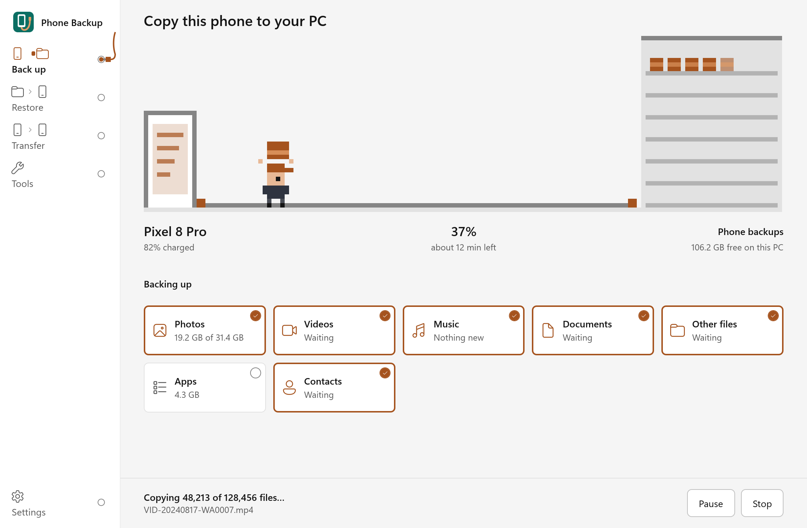

<div align="center">

# Phone Backup

**Back up, restore and move your Android phone with a free Windows app.**<br>
No account, no cloud. Your backup is an ordinary folder on your PC.

[](https://github.com/mitunmanav/phone-backup/releases/latest)
[](https://github.com/mitunmanav/phone-backup/releases)
[](https://github.com/mitunmanav/phone-backup/actions/workflows/ci.yml)
[](LICENSE)

[**Download**](https://phonebackup.oddlybuilt.in/download) | [Website](https://phonebackup.oddlybuilt.in) | [Guide](https://phonebackup.oddlybuilt.in/guide) | [FAQ](https://phonebackup.oddlybuilt.in/faq)

<picture>
  <source srcset="docs/app-dark.png" media="(prefers-color-scheme: dark)">
  
</picture>

</div>

## What it does

| | |
|---|---|
| **Back up** | Photos, videos, files, SD cards and installed apps, plus contacts, call history, messages and the calendar. Pick whole types or single folders; later backups copy only what changed, and you can pause and carry on later. |
| **Restore** | Put files, apps, contacts, call history, calendar and messages back on any Android phone, files all of them or picked from a list with previews. Nothing the phone already has is replaced or added twice. **Verify** on the Restore page checks every file against its SHA-256 checksum. |
| **Phone to phone** | Copy one phone straight to another, contacts and messages included, after seeing what will change and which accounts to sign in to again. |
| **Read and export** | Read a backup's messages, contacts, calls and calendar in the app. Export them as spreadsheets, printable pages, `contacts.vcf` and `.ics`, and sort photos by month. |
| **Tools** | Find duplicates, turn HEIC photos into JPG, merge duplicate contacts, free up phone space once files are safely backed up, and open the phone's screen with [scrcpy](https://github.com/Genymobile/scrcpy). |
| **Connect your way** | USB file transfer, USB debugging, or Wi-Fi by scanning a QR code. The app shows the steps for your phone's brand and can fetch Google's adb for you. |

## Get started

1. [Download](https://phonebackup.oddlybuilt.in/download) `PhoneBackup-<version>-windows-x64.exe` and double-click it. Nothing to install. If Windows warns that the app is not code-signed, choose **More info**, then **Run anyway**.
2. Plug in your phone, unlock it, and choose **File transfer** in its USB notification. For apps, contacts and messages, turn on USB debugging; the app shows how.
3. Press **Back up now**.

The [guide](https://phonebackup.oddlybuilt.in/guide) covers Wi-Fi, restoring and moving to a new phone. Some phones do not allow reading personal data over USB; the app says when that happens.

## Privacy

The app goes online only when you click **Get adb** (to download it from Google) or **Check for updates** (to ask GitHub). It never sends your data: no account, ads or tracking. To read contacts, calls, messages and the calendar, it puts a small open-source helper app on the phone and removes it afterwards. Backups are not encrypted, so keep them on a drive only you use. Details are in the [FAQ](https://phonebackup.oddlybuilt.in/faq#privacy).

## Build from source

Install the stable Rust toolchain with [rustup](https://rustup.rs/), then run this from the repository root on Windows:

```powershell
cargo build --locked --release
```

The executable is `target/release/phone-backup.exe`. The app is written in Rust with [egui](https://github.com/emilk/egui); the phone helper in `companion/` is Kotlin.

## Developer checks

Run these before opening a pull request:

```powershell
cargo fmt --all -- --check
cargo clippy --locked --all-targets -- -D warnings
cargo test --locked
```

CI runs the same checks and a release build on Windows for every pull request. Every merge to `main` that changes the app makes the Release workflow publish the next version (1.0.1, 1.0.2, ...) with SHA-256 checksums, so **Check for updates** finds it.

## Roadmap

Work after 1.0 is split into small groups, and each one ships as its own release. The order, the dependencies and the plan for every group are in [docs/plans](docs/plans/README.md).

**In progress**

- Put contacts, call history, calendar and messages back on a phone ([#90](https://github.com/mitunmanav/phone-backup/pull/90)), and move them in **Phone to phone** too ([#91](https://github.com/mitunmanav/phone-backup/pull/91)).

**Next**

- Backup history: keep older copies of changed files and restore from any earlier backup.
- Password-protected backups, and saving a backup as a single archive.
- WhatsApp: save its local backup and move it to a new Android phone.

**Later**

- More of the phone: settings, wallpapers, ringtones and blocked numbers, where Android allows it.
- Pick single conversations and apps, filter by file type, and see the time left.
- Browse and copy files both ways, and install, save or remove apps.
- Edit contacts and send texts from the PC.
- A photo gallery, search across backups, and imports from Google Takeout and SMS Backup & Restore.
- Erase a phone safely before selling it, and see what fills it up.
- iPhone to Android, read from an ordinary iPhone backup on the PC.
- Keyboard and screen-reader support, and more languages.
- A signed installer, then Mac and Linux builds.

Not planned: scheduled or cloud backups, app private data (Android blocks it without root), and anything that needs an account. [docs/feature-map.md](docs/feature-map.md) compares Phone Backup with other backup apps, feature by feature.

## Contributing

Bug reports and pull requests are welcome; see [CONTRIBUTING.md](CONTRIBUTING.md). Report security problems privately as described in [SECURITY.md](SECURITY.md). Before starting on a bigger change, check the [roadmap](#roadmap) and its plan, so the work lines up; the [Android helper design](docs/android-design.md) covers the phone side.

## License

[GPL-3.0-or-later](LICENSE). Use, share and change it freely; shared copies and changed versions must stay under the same license.
