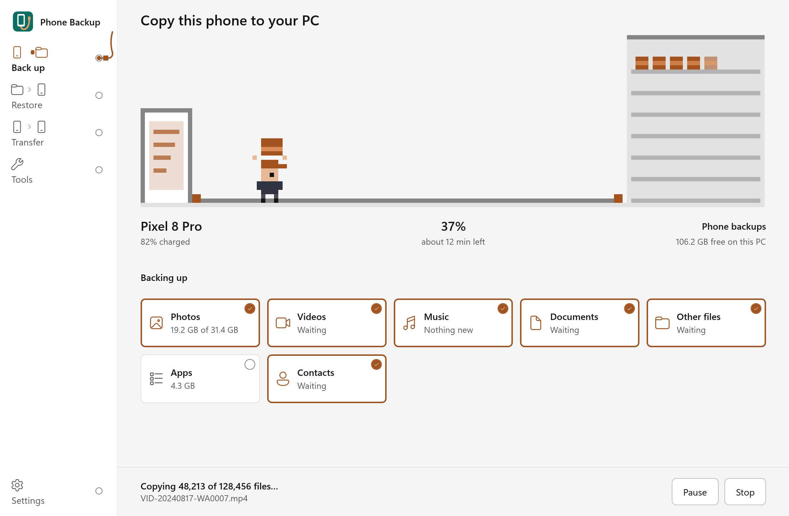

# Phone Backup

**A free, open-source alternative to Wondershare MobileTrans and Dr.Fone.** 
Back up, restore and move your Android phone on Windows. Your backup is a plain folder, and every file in it can be checked.

[**Download for Windows**](https://phonebackup.oddlybuilt.in/download) · [Website](https://phonebackup.oddlybuilt.in) · [Guide](https://phonebackup.oddlybuilt.in/guide) · [FAQ](https://phonebackup.oddlybuilt.in/faq)

<a href="https://www.producthunt.com/posts/phone-backup">
  <picture>
    <source srcset="https://api.producthunt.com/widgets/embed-image/v1/featured.svg?post_id=1318826&theme=dark" media="(prefers-color-scheme: dark)">
    
  </picture>
</a>

<picture>
  <source srcset="docs/app-dark.png" media="(prefers-color-scheme: dark)">
  
</picture>

Backing up a phone. A small courier carries each file along the cable; the tiles below show progress by type.

<table>
  <tr>
    <td width="25%" valign="top"><b>Free, no limits</b> No trial, no paid tier, no feature held back.</td>
    <td width="25%" valign="top"><b>No account, no cloud</b> Your phone goes to your PC and nowhere else.</td>
    <td width="25%" valign="top"><b>Every file checked</b> A SHA-256 checksum for each file, so you can prove the backup is intact.</td>
    <td width="25%" valign="top"><b>Open source</b> GPL-3.0. Anyone can read what it does.</td>
  </tr>
</table>

I wanted to back up my phone without paying a subscription or trusting a cloud I can't see into. Nothing free did all of it, so I built this.

## What it does

- **Back up** photos, videos, files, SD cards and apps, plus contacts, call history, messages and the calendar. Later backups copy only what changed.
- **Restore** to any Android phone. Files already on the phone are never replaced.
- **Phone to phone:** copy one phone straight to another, after seeing what will change.
- **Read and export** messages, contacts, calls and calendar as spreadsheets, printable pages, `.vcf` and `.ics`.
- **Tools** to find duplicates, turn HEIC photos into JPG, merge duplicate contacts and free up phone space once files are safely backed up.

Connect over USB or Wi-Fi (scan a QR code). The app shows the steps for your phone's brand.

## How it compares

| | Phone Backup | MobileTrans | Dr.Fone |
|---|---|---|---|
| Price | Free | $39.99 a year | $99.95 a year (Full Toolkit) |
| Back up an Android phone for free | Yes | No, needs a paid license | Not clear from their site |
| Open the backup without the app | Yes, it's a plain folder | No, a `.bak` file | Not documented |
| Checksum for every file | Yes, SHA-256 | Not documented | Not documented |
| Open source | Yes | No | No |

Prices and limits from Wondershare's own pages for Windows, checked November 2026. More apps and features are compared in the [feature map](docs/feature-map.md). MobileTrans and Dr.Fone do more in some areas, such as iPhone and WhatsApp transfer.

## Get started

1. [Download](https://phonebackup.oddlybuilt.in/download) `PhoneBackup-<version>-windows-x64.exe` and double-click it. Nothing to install. If Windows warns that the app is not code-signed, choose **More info**, then **Run anyway**.
2. Plug in your phone, unlock it, and choose **File transfer** in its USB notification.
3. Press **Back up now**.

Needs Windows 10 or 11 (64-bit) and an Android phone. For apps, contacts and messages, turn on USB debugging; the app shows how. The [guide](https://phonebackup.oddlybuilt.in/guide) covers Wi-Fi, restoring and moving to a new phone.

## Privacy

- No account, ads or tracking. Your data is never sent anywhere.
- The app only goes online when you click **Get adb** (downloads it from Google) or **Check for updates** (asks GitHub).
- To read contacts, calls, messages and the calendar, it installs a small open-source helper on the phone and removes it afterwards.
- Backups are not encrypted yet, so keep them on a drive only you use.

More in the [FAQ](https://phonebackup.oddlybuilt.in/faq#privacy).

## Roadmap

Coming next: putting contacts and messages back on a phone, backup history, password-protected backups, and WhatsApp. The full plan is in [docs/plans](docs/plans/README.md).

## Help and contributing

Found a bug or stuck? [Open an issue](https://github.com/mitunmanav/phone-backup/issues). To build from source or send a pull request, see [CONTRIBUTING.md](CONTRIBUTING.md). Report security problems privately as described in [SECURITY.md](SECURITY.md).

## License

[GPL-3.0-or-later](LICENSE). Use, share and change it freely; shared copies and changed versions must stay under the same license.
